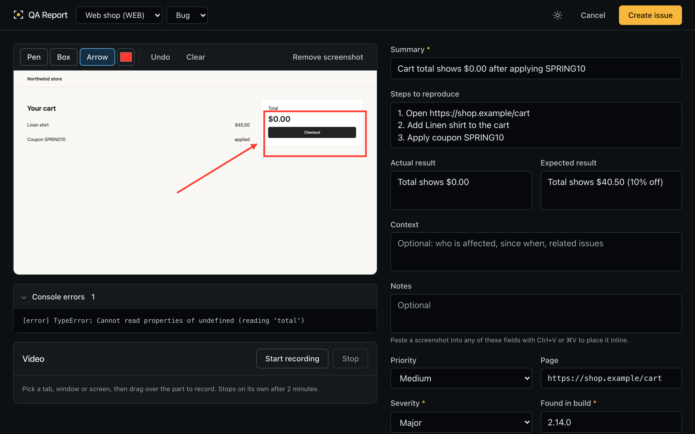
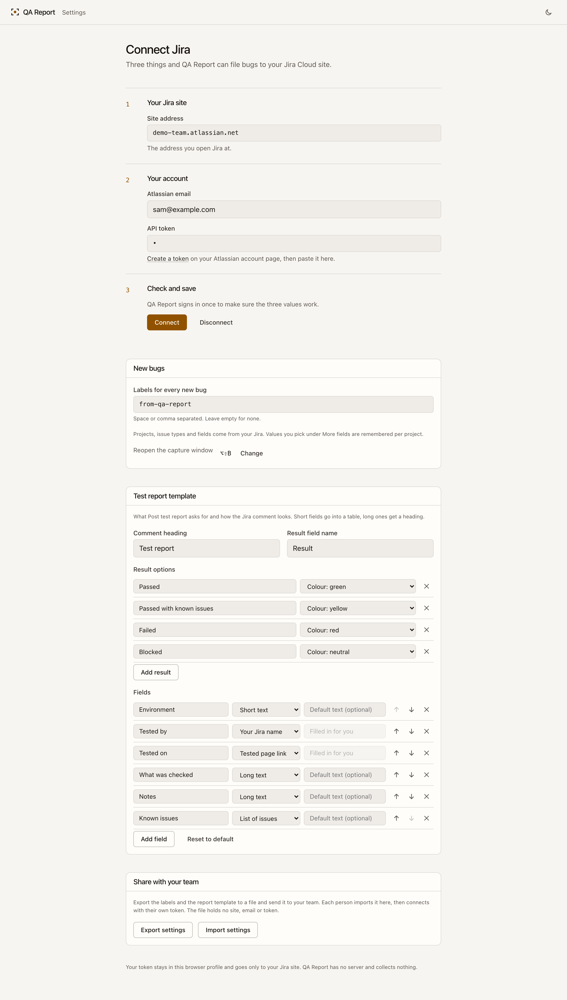
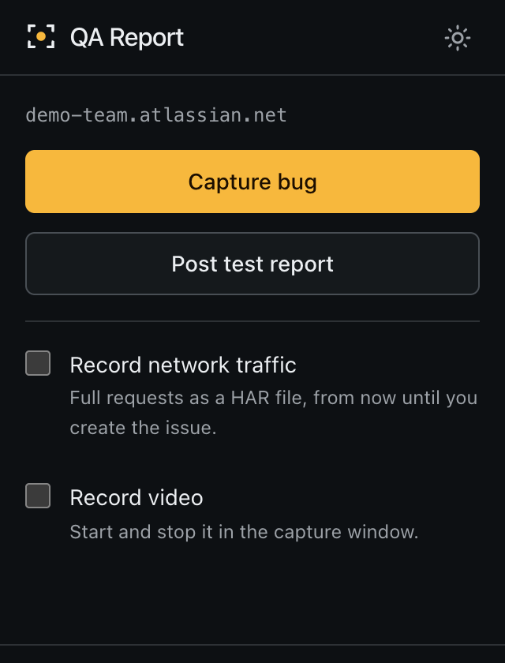
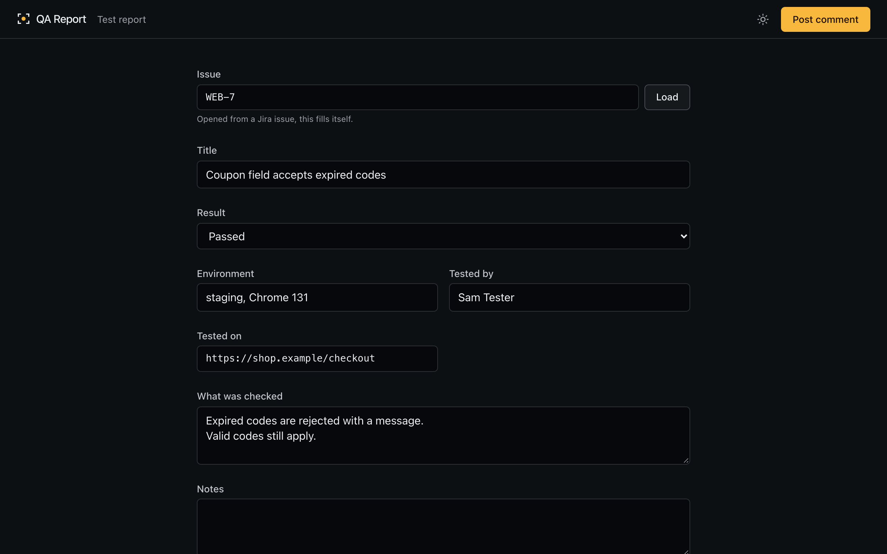
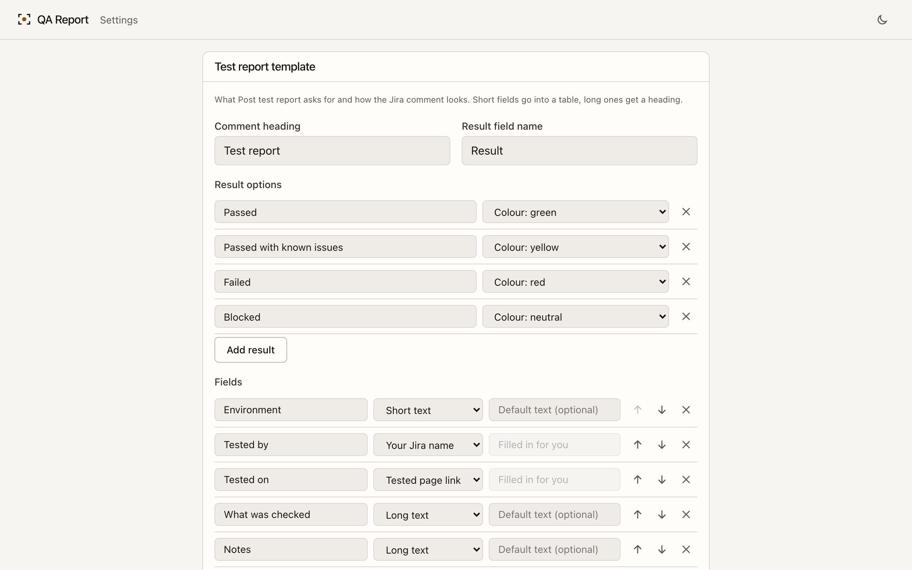

# QA Report for Jira

[Українською](README.uk.md)

A Chrome extension for testers who work in Jira Cloud. It does two things:

1. **Files a bug** from the page you are on: an annotated screenshot, console errors, network log and screen video, attached to a new Jira issue.
2. **Posts a test report** as a comment on an existing issue, using a template your team sets up.



## Install

From the Chrome Web Store, or unpacked:

1. Download or clone this folder.
2. Open `chrome://extensions` and turn on **Developer mode**.
3. Click **Load unpacked** and pick the folder.

## Connect Jira

The settings page opens on first install. It asks for three things:

1. **Site address**, the one you open Jira at, for example `your-team.atlassian.net`.
2. **Atlassian email** of your account.
3. **API token**. Create one at [id.atlassian.com/manage-profile/security/api-tokens](https://id.atlassian.com/manage-profile/security/api-tokens).

Click **Connect**. The extension signs in once to check the values and saves them only when they work.

Open the settings again from the popup, or right click the toolbar icon and pick **Options**.



## What adapts to your Jira on its own

Nothing about your Jira is built in. Every time the capture window opens, it reads your Jira:

- the projects you can create issues in, and their issue types;
- the priorities, if the project uses them;
- every **required** field of that issue type, shown in the form with a fitting control (a list, text, number, date or a person search);
- every other field the create screen offers, under **More fields**.

What you pick under **More fields** is remembered per project. If your team files every bug with a "Product area" or a component, choose it once and it stays filled in.

If your Jira admin adds a field tomorrow, it shows up in the form with no update to the extension.

## Set it up for a team

Each person connects with their own email and token; those never leave their browser. Everything else can be shared:

1. One person sets the **labels** and the **test report template** in Settings.
2. They click **Export settings** and send `qa-report-settings.json` to the team.
3. Everyone else clicks **Import settings**, picks the file, then connects with their own token.

The file holds labels and the template only. It has no site address, email or token.

## File a bug

1. On the page with the bug, click the extension icon.
2. Optionally tick **Record network traffic** or **Record video**.
3. Click **Capture bug**. A window opens with the screenshot and the console errors.
4. Pick the project and issue type at the top. They are remembered for next time.
5. Draw on the screenshot with Pen, Box or Arrow. Write the summary, steps, actual and expected result. Paste screenshots straight into any text field.
6. Click **Create issue**. The issue opens in a new tab.



### What ends up in Jira

| Where | What |
| --- | --- |
| Description | Coloured panels for steps, actual result, expected result, context and notes, plus an environment panel with the page URL, browser, viewport and time |
| Attachments | `screenshot.png`, `console-log.txt`, `network-log.txt` and `network.har` when recorded, `video-N.mp4` per clip, pasted images |
| Fields | Priority, the required fields and whatever you set under More fields |
| Labels | The labels from Settings, if any |

A pasted image or a video clip shows inline in its panel. If Jira cannot give an inline id for a file, it stays a plain attachment with a link.

### Network recording

**Record network traffic** attaches Chrome's debugger to the tab and records full requests and responses as a HAR file, from the capture until you click **Create issue**. Reproduce the bug again while the window is open to catch it. Chrome shows a "being debugged" bar on that tab meanwhile, and the recording cannot start while DevTools is open on the tab.

Without it, the extension still attaches a list of the last 50 requests (method, status, URL).

Scripts, styles, fonts and images are left out of the HAR. Change `EXCLUDED_MIME_TYPES` in `har.js` to keep them.

### Video

**Record video** adds a video panel to the capture window. Click **Start recording**, choose a tab, window or screen, then drag over the part you want. Each clip stops at 2 minutes. Record as many as you need, delete the ones you do not, and choose which section each clip appears in.

Video is H.264 MP4 at about 4 Mbit/s, so a full 2-minute 1080p clip is about 57 MB. Crop to a smaller area for smaller files. If your Jira rejects large attachments, lower `VIDEO_BITS_PER_SECOND` in `capture.js`.

## Post a test report

1. Open the Jira issue you tested, or the app you tested it in.
2. Click the extension icon, then **Post test report**.
3. Pick the result and fill in the fields. Add evidence files: drop, choose or paste them.
4. Click **Post comment**. The issue opens scrolled to the new comment.

The form keeps a draft while you type.



### The report template

Settings has a **Test report template** editor. It sets:

- the comment heading, for example "Test report" or "QA check";
- the result options and their colour in Jira;
- the fields, in order, each with a type and optional default text.

| Field type | In the form | In the Jira comment |
| --- | --- | --- |
| Short text | one line | a row of the table |
| Your Jira name | filled in with your name | a row of the table |
| Tested page link | filled in with the page you tested | a linked row of the table |
| Long text | a text box | a heading and a quote |
| List of issues | one per line | a heading and a list, issue keys linked |

Empty fields are left out of the comment. **Reset to default** brings back the original template.



## Shortcut

<kbd>Alt</kbd>+<kbd>Shift</kbd>+<kbd>B</kbd> brings the open capture window to the front. Change it at `chrome://extensions/shortcuts`.

## Troubleshooting

| Message | Fix |
| --- | --- |
| Jira rejected the email or API token | Create a new token and connect again. The email must belong to the Atlassian account that owns the token. |
| Could not reach your-team.atlassian.net | Check the site address. Only Jira Cloud works, not Jira Server or Data Center. |
| Required by Jira: Field name | Fill in that field in the form. |
| QA Report cannot fill this field type | Your Jira requires a field of a type the extension does not support. Ask your Jira admin to give it a default value or make it optional for this issue type. |
| Network recording skipped | Close DevTools on that tab and capture again. |
| Chrome does not allow capturing this page | Chrome blocks extensions on `chrome://` pages and the Chrome Web Store. |

## Privacy

Your API token is kept in `chrome.storage.local` in this browser profile and is sent only to your Jira site. The extension has no server, no analytics and no tracking. See [PRIVACY.md](PRIVACY.md).

## Development

No build step. Edit the files and reload the extension on `chrome://extensions`.

```bash
npm test        # self-checks for the pure logic, plain Node
npm run zip     # qa-report-for-jira.zip for the Chrome Web Store
```

| File | Role |
| --- | --- |
| `background.js` | Service worker: console and network buffers, HAR recording, capture, inline media ids |
| `console-hook.js` | Runs in the page's own world and reports its `console.error` and `console.warn` calls |
| `content.js` | Runs in every frame from page load and forwards console entries, uncaught errors and failed resources |
| `jira.js` | Jira REST calls and the pure builders: field values, description, report template, settings file |
| `capture.html/js` | The capture window: annotation, form, video, issue creation |
| `report.html/js` | The test report window |
| `popup.html/js`, `options.html/js` | Toolbar popup and settings with the template editor |
| `har.js`, `rich-field.js` | HAR builder and rich-text serializer, both pure |
| `ui.css`, `tokens.css`, `base.css` | Styles, light and dark |

Icons are prebuilt. After editing `icons/icon.svg`:

```bash
npm i --no-save playwright && node icons/generate-icons.mjs
```
