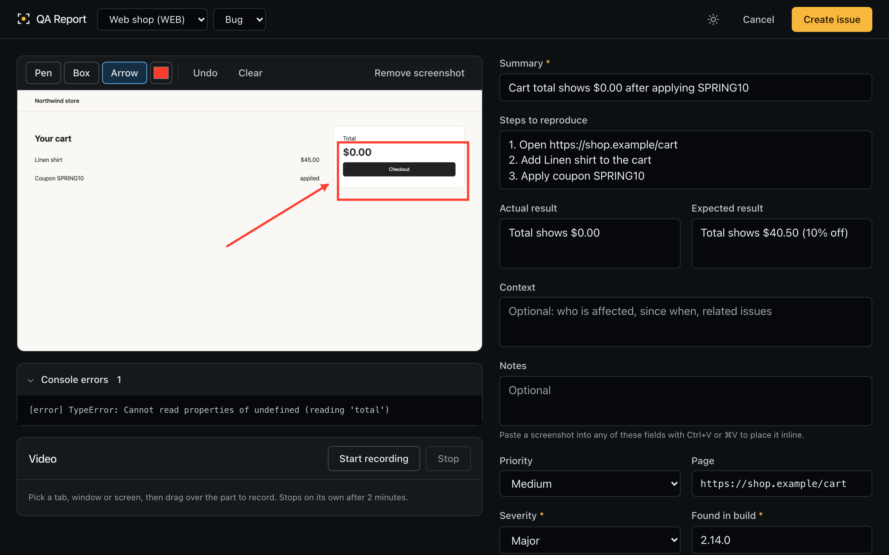
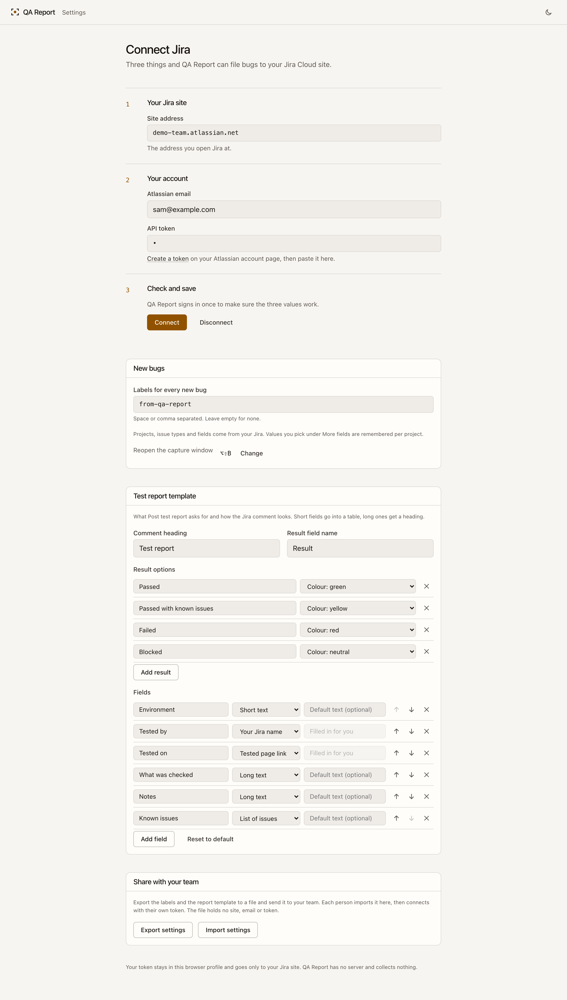
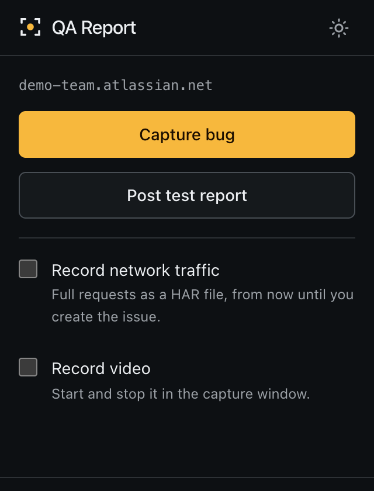
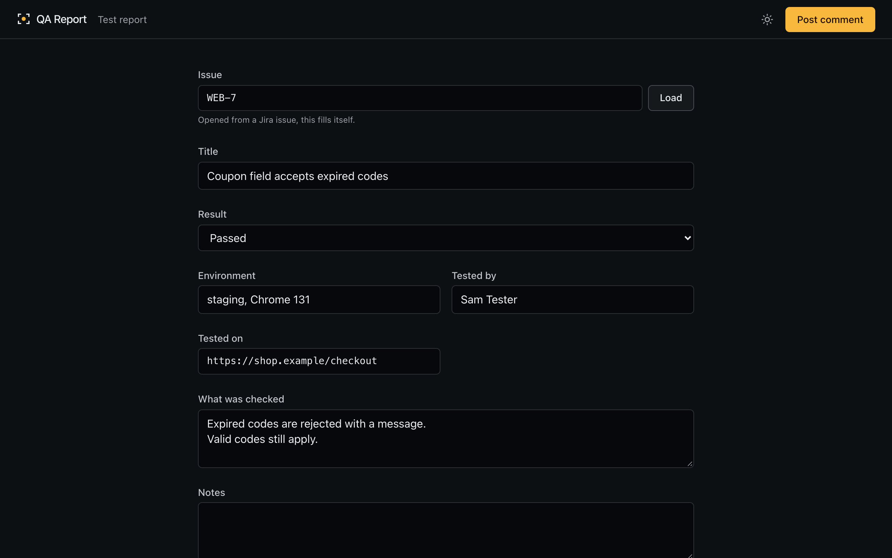
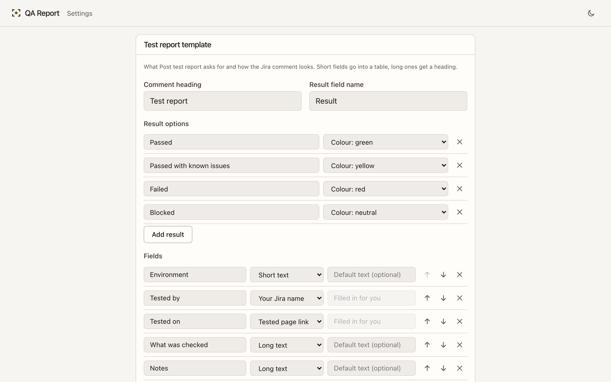

# QA Report for Jira

[English](README.md)

Розширення для Chrome для тестувальників, які працюють у Jira Cloud. Воно робить дві речі:

1. **Заводить баг** зі сторінки, де ти зараз: скріншот з позначками, помилки консолі, мережевий лог і відео екрана йдуть у нову задачу Jira.
2. **Пише тест-репорт** коментарем до наявної задачі за шаблоном, який налаштовує твоя команда.



## Встановлення

З Chrome Web Store або вручну:

1. Завантаж або склонуй цю папку.
2. Відкрий `chrome://extensions` і ввімкни **Developer mode**.
3. Натисни **Load unpacked** і вибери папку.

## Підключення Jira

Після встановлення сама відкривається сторінка налаштувань. Там три поля:

1. **Site address**: адреса, за якою ти відкриваєш Jira, наприклад `your-team.atlassian.net`.
2. **Atlassian email** твого акаунта.
3. **API token**. Створи його на [id.atlassian.com/manage-profile/security/api-tokens](https://id.atlassian.com/manage-profile/security/api-tokens).

Натисни **Connect**. Розширення один раз входить у Jira, щоб перевірити дані, і зберігає їх тільки тоді, коли вони працюють.

Налаштування знову відкриваються з попапа або через правий клік на іконці, пункт **Options**.



## Що підлаштовується під твою Jira саме

У розширення не вшито нічого з конкретної Jira. Щоразу, коли відкривається вікно бага, воно читає твою Jira:

- проєкти, де ти можеш створювати задачі, і їхні типи задач;
- пріоритети, якщо проєкт їх використовує;
- усі **обов'язкові** поля цього типу задачі. Кожне з'являється у формі з відповідним контролом: список, текст, число, дата або пошук людини;
- решту полів з екрана створення, у секції **More fields**.

Те, що ти вибрав у **More fields**, запам'ятовується для кожного проєкту окремо. Якщо команда кожен баг заводить із "Product area" чи компонентом, вибери його один раз, і далі він підставлятиметься сам.

Якщо адмін Jira завтра додасть нове поле, воно з'явиться у формі без оновлення розширення.

## Налаштування для команди

Кожен підключається своїм email і токеном, і вони не виходять за межі його браузера. Решту можна поширити:

1. Одна людина налаштовує **лейбли** і **шаблон тест-репорту** в Settings.
2. Натискає **Export settings** і надсилає команді файл `qa-report-settings.json`.
3. Решта натискає **Import settings**, вибирає файл і підключається своїм токеном.

У файлі тільки лейбли й шаблон. Адреси сайту, email і токена там немає.

## Як завести баг

1. На сторінці з багом натисни іконку розширення.
2. За потреби постав галочку **Record network traffic** або **Record video**.
3. Натисни **Capture bug**. Відкриється вікно зі скріншотом і помилками консолі.
4. Вгорі вибери проєкт і тип задачі. Вони запам'ятовуються на наступний раз.
5. Познач на скріншоті потрібне: Pen, Box або Arrow. Заповни summary, кроки, фактичний і очікуваний результат. Скріншот можна вставити прямо в текстове поле.
6. Натисни **Create issue**. Задача відкриється в новій вкладці.



### Що потрапляє в Jira

| Куди | Що |
| --- | --- |
| Description | Кольорові панелі з кроками, фактичним і очікуваним результатом, контекстом і нотатками, плюс панель середовища: URL сторінки, браузер, розмір вікна і час |
| Attachments | `screenshot.png`, `console-log.txt`, `network-log.txt`, `network.har` якщо був запис мережі, `video-N.mp4` на кожен кліп, вставлені картинки |
| Поля | Пріоритет, обов'язкові поля і все, що задано в More fields |
| Labels | Лейбли з налаштувань, якщо вони є |

Вставлена картинка чи відеокліп показуються прямо в панелі. Якщо Jira не віддала id для вбудовування, файл лишається звичайним вкладенням з посиланням.

### Запис мережі

**Record network traffic** підключає дебагер Chrome до вкладки і пише повні запити та відповіді у HAR-файл від моменту захоплення до натискання **Create issue**. Поки вікно відкрите, відтвори баг ще раз, щоб він потрапив у запис. На цей час Chrome показує на вкладці смугу "being debugged". Запис не стартує, якщо на вкладці відкриті DevTools.

Без цієї галочки розширення все одно прикладає список останніх 50 запитів (метод, статус, URL).

Скрипти, стилі, шрифти й картинки в HAR не потрапляють. Щоб залишити їх, зміни `EXCLUDED_MIME_TYPES` у `har.js`.

### Відео

**Record video** додає у вікно бага панель відео. Натисни **Start recording**, вибери вкладку, вікно або екран і виділи потрібну область. Кожен кліп зупиняється на 2 хвилинах. Записуй скільки треба, видаляй зайве і вибирай, у якій секції показати кожен кліп.

Відео пишеться в H.264 MP4 приблизно 4 Мбіт/с, тобто повний 2-хвилинний кліп 1080p важить близько 57 МБ. Менша область дає менший файл. Якщо Jira не приймає великі вкладення, зменш `VIDEO_BITS_PER_SECOND` у `capture.js`.

## Як написати тест-репорт

1. Відкрий задачу Jira, яку тестував, або застосунок, у якому тестував.
2. Натисни іконку розширення, потім **Post test report**.
3. Вибери результат і заповни поля або натисни **Fill with AI**. Додай файли-докази: перетягни, вибери або встав.
4. Натисни **Post comment**. Задача відкриється на новому коментарі.

Якщо ключ ввести вручну, задача завантажиться після Enter або коли перейдеш в інше поле. Поки ти пишеш, форма зберігає чернетку.

### Fill with AI

**Fill with AI** читає опис задачі й коментарі та заповнює довгі текстові поля шаблону і список
issues: що перевіряли і як. Найбільшу вагу мають коментарі самого тестувальника, пізніші коментарі
важать більше за опис. Перечитай результат перед відправкою.

Працює через Claude Code або Codex на твоєму комп'ютері, з акаунтом, у який залогінений CLI. Тобто
йде по твоїй підписці Claude або ChatGPT, API-ключ не потрібен. Налаштування один раз, на Windows, macOS або Linux:

1. Встанови один CLI і залогінься: `npm i -g @anthropic-ai/claude-code && claude` або
   `npm i -g @openai/codex && codex login`.
2. Встанови [Node.js](https://nodejs.org), якщо його немає, потім натисни **Fill with AI** і дозволь те, що попросить Chrome.
3. Форма покаже команду з ID твого розширення: для PowerShell на Windows, для Terminal на інших системах. Скопіюй, запусти й натисни
   **Fill with AI** ще раз. Команда кладе маленький скрипт-місток у `~/.qa-report-for-jira`
   (на Windows у `%LOCALAPPDATA%\qa-report-for-jira`) і реєструє його в Chrome.

У Settings можна вибрати, який CLI використовувати. CLI працює в порожній папці без інструментів,
тож бачить тільки текст задачі, який передає розширення.



### Шаблон репорту

У Settings є редактор **Test report template**. Він задає:

- заголовок коментаря, наприклад "Test report" або "QA check";
- варіанти результату і їхній колір у Jira;
- поля по порядку, кожне з типом і текстом за замовчуванням.

| Тип поля | У формі | У коментарі Jira |
| --- | --- | --- |
| Short text | один рядок | рядок таблиці |
| Your Jira name | підставляється твоє ім'я | рядок таблиці |
| Tested page link | підставляється сторінка, яку ти тестував | рядок таблиці з посиланням |
| Long text | текстове поле | заголовок і цитата |
| List of issues | по одному в рядку | заголовок і список, ключі задач стають посиланнями |

Порожні поля в коментар не потрапляють. **Reset to default** повертає початковий шаблон.



## Гаряча клавіша

<kbd>Alt</kbd>+<kbd>Shift</kbd>+<kbd>B</kbd> виводить відкрите вікно бага на передній план. Змінити її можна на `chrome://extensions/shortcuts`.

## Якщо щось не так

| Повідомлення | Що зробити |
| --- | --- |
| Jira rejected the email or API token | Створи новий токен і підключись ще раз. Email має належати тому акаунту Atlassian, на якому створено токен. |
| Could not reach your-team.atlassian.net | Перевір адресу сайту. Працює тільки Jira Cloud, не Jira Server і не Data Center. |
| Required by Jira: назва поля | Заповни це поле у формі. |
| QA Report cannot fill this field type | Jira вимагає поле типу, який розширення не підтримує. Попроси адміна Jira дати полю значення за замовчуванням або зробити його необов'язковим для цього типу задачі. |
| Network recording skipped | Закрий DevTools на цій вкладці й захопи ще раз. |
| Chrome does not allow capturing this page | Chrome не пускає розширення на сторінки `chrome://` і в Chrome Web Store. |
| Fill with AI is not connected to this computer yet | Зроби кроки з повідомлення: встанови CLI, запусти показану команду, натисни ще раз. |
| claude or codex not found on PATH | Встанови CLI і запусти команду налаштування ще раз, щоб місток його побачив. |
| claude failed / codex failed | Запусти `claude` або `codex` у Terminal або PowerShell і перевір, що він залогінений і оновлений. |

## Приватність

API-токен лежить у `chrome.storage.local` цього профілю браузера і надсилається тільки на твій сайт Jira. У розширення немає сервера, аналітики й трекінгу. **Fill with AI** передає текст задачі в Claude Code або Codex на твоєму комп'ютері, а той надсилає його в Anthropic або OpenAI під твоїм акаунтом. Деталі в [PRIVACY.md](PRIVACY.md).

## Розробка

Збирати нічого не треба. Редагуй файли й перезавантаж розширення на `chrome://extensions`.

```bash
npm test        # самоперевірки чистої логіки, звичайний Node
npm run zip     # qa-report-for-jira.zip для Chrome Web Store
```

Опис файлів дивись в [англійській версії](README.md#development).
